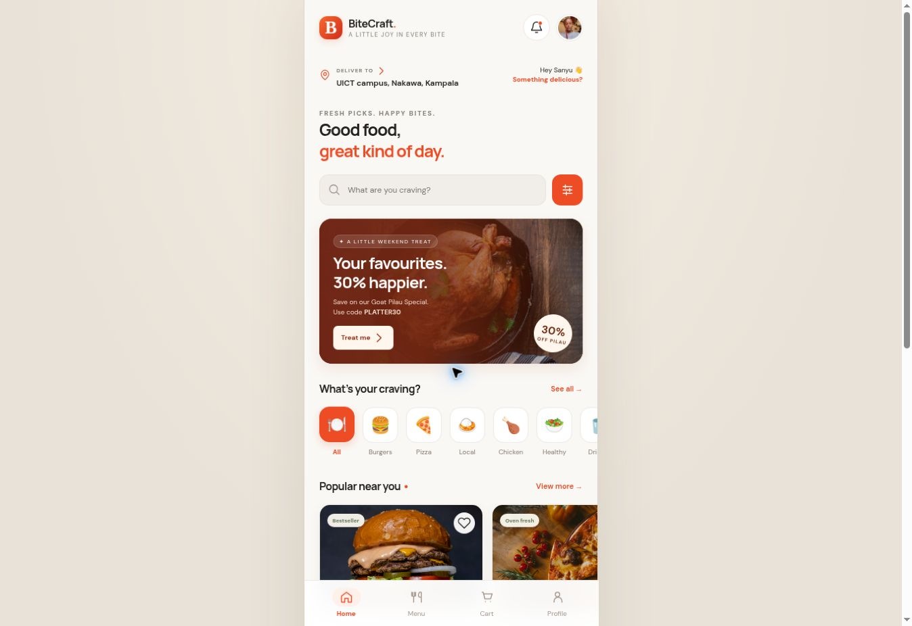

# BiteCraft

**Food for everyone. A mobile food-ordering interface for Sanyu Judith.**

Built from the supplied Figma prototype screenshots using plain HTML, CSS and JavaScript. The app stays **phone-width (maximum 440px)** even on a large desktop screen.



## Run locally

With Node.js 20 or newer:

```sh
npm run dev
```

Open `http://localhost:3000`. There are no npm dependencies to install and no build step. Use localhost or HTTPS for account creation, because password hashing uses Web Crypto. Alternatively, serve the repository root with any static server. Opening `index.html` directly is less reliable because browser storage and cryptographic APIs vary for `file:` URLs.

## Deploy on Vercel

1. Import **abarintuma/bite-craft** into Vercel.
2. Choose **Other** as the Framework Preset.
3. Keep the Root Directory at the repository root (`./`).
4. Leave the Build Command blank and disabled.
5. Set Output Directory to `.` if Vercel asks for one (static files are at the repository root).
6. Deploy and open the HTTPS URL.

No environment variables, database or API keys are needed. Hash routes such as `/#menu` work with static hosting; no SPA catch-all rewrite is necessary.

## Working features

- Welcome, sign-in, local account creation and sign-out.
- Guest browsing as **Sanyu Judith**.
- 24 dishes across burgers, pizza, local meals, chicken, healthy choices, drinks, desserts and breakfast.
- Search, recent searches, food-type filtering, budget filters and sorting.
- Dish details, ingredients, allergen notes, regular/large sizes, spice choices, kitchen notes and quantity controls.
- Cart with editable quantities, removal, clearing and UGX totals.
- `BITEWELCOME`: UGX 5,000 off a food subtotal of UGX 25,000 or more.
- `PLATTER30`: 30% off Goat Pilau Special items, including selected size. One coupon per order.
- Delivery (UGX 3,500) or free pickup; saved addresses and directions.
- Validated demo checkout and cash/mobile-money/card preferences.
- Confirmation, receipt, order history, reorder and manually simulated tracking.
- Favourites, in-app notifications, help, privacy information and profile settings.
- Profile photo upload and default-photo restoration.

**Every newly created account uses the supplied Sanyu Judith photograph.** A different account name does not change the photo. Users can replace it only in Settings. Each account’s uploaded photo, cart, favourites and orders stay separate from the guest profile and other local accounts.

## Demo boundaries

This is a functional **front-end assignment demonstration**, not a live restaurant service:

- Accounts, addresses, carts and orders exist only in the current browser’s local storage. They do not sync to another browser or device.
- Passwords are derived with PBKDF2-SHA256 (100,000 iterations and a random salt). Browser-local sign-in is not production authentication. Use a demo-only password.
- Payments, notifications and delivery are simulated. No card details, mobile-money prompt, real email or SMS is used.
- Menu ratings, prices, offers and estimated times are sample data. Food photos are representative; some dishes share category imagery.
- Google Fonts are optional; all food photos and the default profile photo are bundled locally.
- A real service needs a backend, authoritative server prices, production authentication, payment integration and fulfilment.

## Assignment documentation

- [Illustrated report, web edition](docs/report.html)
- [Illustrated report, PDF](docs/BiteCraft_Project_Report.pdf)
- [Testing evidence](docs/TESTING.md)
- [Asset credits](docs/ASSET-CREDITS.md)
- [Reconstructed wireframes](docs/wireframes.png)
- [Supplied Figma overview](docs/figma-overview.jpg)
- [Manual responsive layout fixture](tests/responsive.html)

The report includes requirements analysis, audience assumptions, problem statement, ideation, wireframes, Figma references, implementation screenshots, validation, testing and a presentation walkthrough.

**Before academic submission:** add the actual Figma project URL, original paper sketches and findings from any interviews or surveys actually conducted. No research participants, results or quotations have been invented. The digital wireframes are reconstructions, not original paper sketches.

## Verify

```sh
npm test
npm run check
```

Nine tests cover pricing, discounts, catalogue integrity, combined filtering, escaping, account isolation, default-photo behaviour, password validation and non-secure-preview cart IDs. They run entirely with Node built-ins.

To rebuild the report after updating the captured screenshots:

```sh
python -m pip install reportlab pillow
python scripts/build-report.py
```

## Source map

| Path | Purpose |
| --- | --- |
| `index.html` | Semantic app shell |
| `styles.css` | Brand, mobile layout and components |
| `app.js` | Menu, routing, state and interaction logic |
| `assets/` | Bundled photos and favicon |
| `docs/` | Reports, supplied references and screenshots |
| `tests/` | Automated tests and responsive fixture |
| `scripts/serve.cjs` | Dependency-free development server |
| `scripts/build-report.py` | Reproducible illustrated report generation |
| `vercel.json` | Static deployment configuration |
