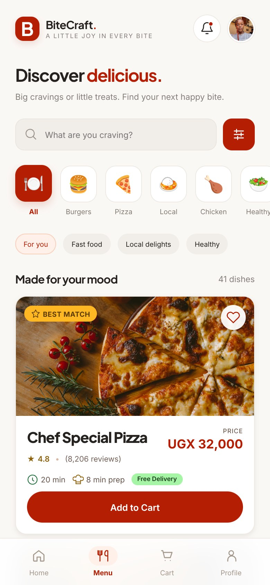

# BiteCraft

**Sanyu Judith · UI/UX Design coursework**

BiteCraft is a mobile food-ordering interface built with HTML, CSS and JavaScript. Users can explore food and drinks, customise a dish, review their cart and record an order.

[Open BiteCraft](https://bite-craft-lemon.vercel.app/) · [Read the PDF report](docs/BiteCraft_Project_Report.pdf) · [Open the Figma designs](https://www.figma.com/design/uXvZEoR0YnAhbe41bstIhl/food-deliver?node-id=0-1)



## Run the application

Use Node.js 20 or later. No package installation is needed.

```sh
npm run dev
```

Open `http://localhost:3000`. Choose **Get started** to sign in or create an account, or use **Browse the menu** to explore as Sanyu Judith.

## Main journey

Home → Menu → Food details → Cart → Checkout → Order confirmation.

- Browse 41 dishes across 11 categories, search the menu and filter by budget.
- Select size, spice level and quantity, and add a kitchen note.
- Edit the cart, choose delivery or pickup and review UGX totals.
- Apply `BITEWELCOME` for 5,000 UGX off a food subtotal of at least 25,000 UGX.
- Apply `PLATTER30` for 30% off eligible Chicken Pilau Special items.
- Save favourites, addresses and orders; view order history and tracking.
- Create a separate account and change the profile photo in Settings.

The interface keeps a maximum width of 440 pixels. Main food lists have one full-width card per row; category and popular-food rows scroll horizontally. The primary colour is `#B41F04`, with Plus Jakarta Sans headings and Inter body text. Sanyu Judith's photograph is the default for every account until it is changed in Settings. Food photographs use external URLs.

## Coursework documents

| Material | Location |
| --- | --- |
| Illustrated PDF report | [BiteCraft Project Report](docs/BiteCraft_Project_Report.pdf) |
| Research and intended users | [User research](docs/RESEARCH.md) |
| Problem and main requirements | [Requirements](docs/REQUIREMENTS.md) |
| Design decisions and Figma links | [Design notes](docs/DESIGN.md) |
| Original paper sketches | [Hand-drawn sketches](docs/design/paper-sketches.jpeg) |
| Figma screen exports | [Design evidence](docs/design/README.md) |
| Mobile website screenshots | [Implementation screenshots](docs/screenshots/README.md) |
| Test results | [Testing](docs/TESTING.md) |
| Presentation walkthrough | [Presentation guide](docs/PRESENTATION.md) |
| Assignment instructions | [Assignment image](docs/assignment/assignment.jpg) |

[Browse the document index](docs/README.md).

## Repository layout

| Path | Purpose |
| --- | --- |
| `index.html` | Application page and asset loading |
| `app.js` | Menu, screens, navigation and interactions |
| `styles.css` | Colours, typography, cards and responsive layout |
| `assets/` | Profile photograph and favicon |
| `docs/` | Report, assignment, sketches, design exports and screenshots |
| `tests/` | Automated checks and responsive layout fixture |
| `scripts/` | Local server and PDF report builder |
| `vercel.json` | Static hosting configuration |

## Check the application

```sh
npm test
npm run check
```

The ten automated tests cover menu data, totals, offers, filtering, account separation and the default photo.

## Rebuild the report

```sh
python -m pip install reportlab pillow
python scripts/build-report.py
```

The builder uses the paper sketches, Figma exports and mobile screenshots in `docs/` to produce the PDF.

## Deploy

Import [abarintuma/bite-craft](https://github.com/abarintuma/bite-craft) into Vercel. Select **Other** as the framework, keep the repository root, leave the build command empty and use `.` as the output directory. The included configuration supports the application's hash routes.

## Images and credits

[Photo credits](docs/photo-credits.html) · [Asset sources](docs/ASSET-CREDITS.md).

Account and order records are kept in the browser. Checkout records the selected payment preference; payment processing and the delivery timeline are demonstrations.
