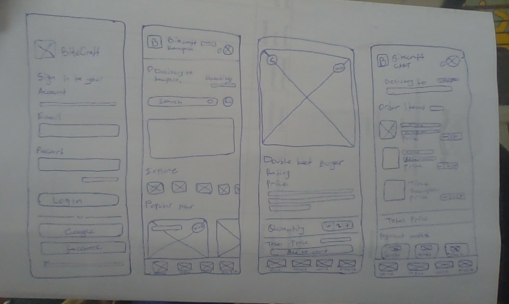

# BiteCraft coursework guide

**Group C | UI/UX Design | 7 November 2026**

[Website](https://bite-craft-lemon.vercel.app/) · [Repository](https://github.com/abarintuma/bite-craft) · [PDF report](BiteCraft_Project_Report.pdf)

## Assignment and submission

The [assignment image](assignment/assignment.jpg) asks for the following work. Each submission item is linked below.

| Assessment area | Marks | Evidence |
| --- | ---: | --- |
| User research and problem definition | 15 | Research and requirements below; PDF page 2 |
| Ideation and paper sketches | 15 | [Original sketches](design/paper-sketches.jpeg); PDF page 3 |
| High-fidelity Figma designs | 25 | Figma links and exports below; PDF page 4 |
| HTML, CSS and JavaScript implementation | 30 | [HTML](../index.html), [CSS](../styles.css), [JavaScript](../app.js), [working website](https://bite-craft-lemon.vercel.app/) |
| Documentation and presentation | 15 | [PDF project report](BiteCraft_Project_Report.pdf), screenshots and demonstration walkthrough below |
| **Total** | **100** | |

Submit the PDF report, original paper sketches, Figma project link and application source, and demonstrate the working interfaces. The walkthrough below helps the group prepare the presentation.


# 1. User research and problem definition

## Purpose and approach

The research focuses on the tasks involved in choosing and ordering a meal on a phone. It uses a review of the paper sketches and Figma screens, followed by a task walkthrough of the interface. The main tasks are finding a dish, checking its price, choosing options and confirming the final total.

## Intended users

| User group | Typical need | Design response |
| --- | --- | --- |
| Students | Find a meal within a budget | Visible UGX prices, search and budget filters |
| Busy workers | Choose and order quickly | Categories, a clear cart and saved addresses |
| Returning customers | Find familiar meals again | Favourites, order history and reorder |

## Needs identified

1. Customers need to compare dishes using a name, photograph and price.
2. Size, spice and quantity choices should be clear before adding a dish.
3. The cart should show quantities, discounts, delivery cost and the final total.
4. Users need a clear next action and a way to return to the menu.
5. Feedback should confirm that an item or order has been saved.

These needs are addressed by the food cards, dish details, editable cart, bottom navigation and confirmation screen.

## Example scenario

A customer wants two burgers with extra serving size and no onions. They open the burger details, choose Large and Hot, set the quantity to two and add a note. In the cart, they apply the welcome code, review the total and continue to checkout.

## Questions for user feedback

- Can you find a meal or drink within your budget?
- Is it clear how to choose a size and change the quantity?
- Can you explain the total after a coupon is applied?
- Is the delivery address easy to find and change?
- What part of the ordering process needs fewer steps?

The findings above come from task analysis. These questions can be used for participant feedback without treating them as completed interview results.


## Problem and requirements

## Problem statement

Customers need a clear way to choose food, customise an order and understand the final cost. If prices, options or delivery charges are hard to find, it is easy to make a mistake. BiteCraft brings these steps into one mobile ordering journey.

## Main requirements

| ID | Requirement | Application feature |
| --- | --- | --- |
| R1 | Browse food and drinks | Home, Menu and categories |
| R2 | Find suitable dishes | Search, sorting and budget filters |
| R3 | Inspect and customise a meal | Description, price, size, spice, quantity and notes |
| R4 | Review an order | Editable cart and itemised totals |
| R5 | Enter delivery details | Address selection, checkout and validation |
| R6 | See the result of ordering | Confirmation, receipt and order history |
| R7 | Move easily between screens | Home, Menu, Cart and Profile navigation |
| R8 | Return to saved choices | Accounts, favourites and saved addresses |
| R9 | Use the interface on a phone | Phone-width layout and one main card per row |

## Main journey

Home → Menu → Food details → Cart → Checkout → Confirmation.

## Calculation rules

- A Large serving adds 5,000 UGX to the dish price.
- The subtotal is the sum of each selected price multiplied by its quantity.
- `BITEWELCOME` takes 5,000 UGX off a food subtotal of at least 25,000 UGX.
- `PLATTER30` discounts eligible Chicken Pilau Special items by 30%.
- Only one coupon is used per order.
- Delivery costs 3,500 UGX, while pickup is free. A Free Delivery dish waives the order delivery fee.
- Total = subtotal − discount + delivery.

## Form rules

Account creation requires a name, a valid email and a password of at least eight characters. Checkout requires a name, a valid phone number, a complete delivery address when needed, and order confirmation. Kitchen notes are optional.


# 2. Ideas and interface design

## Design thinking

The design starts with the customer's main task: choose a meal and review the cost before confirming it. The paper sketches organise the screen layout. The Figma designs add colour, typography, photographs and detailed controls. The web interface turns these controls into working navigation and forms.

## Ideas considered

| Idea | Benefit | Decision |
| --- | --- | --- |
| Place all options on the menu card | Fewer screen changes | Cards become crowded |
| Open a separate food details screen | More room for description and choices | Selected for customisation |
| Confirm immediately after adding food | Shorter journey | Little opportunity to review quantities |
| Review the cart before checkout | Makes prices and choices visible together | Selected for order review |

## Paper sketches



The sketches show Login, Home, Food details and Cart. They establish the placement of the search field, food photographs, quantities, totals and bottom navigation.

## High fidelity design

[Open the Figma project](https://www.figma.com/design/uXvZEoR0YnAhbe41bstIhl/food-deliver?node-id=0-1).

The file contains Welcome, Login, Home, Menu, Food details, Cart and Profile screens. [Direct screen links and exported designs](#figma-screens) are included with the documentation.

| Element | Choice |
| --- | --- |
| Primary colour | `#B41F04` |
| Heading font | Plus Jakarta Sans |
| Body font | Inter |
| Main food lists | One full-width card per row |
| Category and popular-food rows | Horizontal scrolling |
| Navigation | Home, Menu, Cart and Profile |
| Default profile image | Supplied Sanyu Judith photograph |

Food cards group the photo, name and price, rating, timing and delivery information, followed by an Add to Cart button. The app keeps the mobile layout at a maximum width of 440 pixels on wider screens.

## Feedback and accessibility

Labels identify form fields, error messages explain invalid entries, and messages confirm saved actions. Buttons have focus styles, images have alternative text, and the navigation labels remain visible. The selected size, spice and payment choice have visible states.


## Figma screens

[Open the editable Figma file](https://www.figma.com/design/uXvZEoR0YnAhbe41bstIhl/food-deliver?node-id=0-1).

| Screen | Direct Figma link | Export |
| --- | --- | --- |
| Welcome | [Open](https://www.figma.com/design/uXvZEoR0YnAhbe41bstIhl/food-deliver?node-id=48-117) | [Overview](design/figma-overview.jpg) |
| Login | [Open](https://www.figma.com/design/uXvZEoR0YnAhbe41bstIhl/food-deliver?node-id=47-55) | [Overview](design/figma-overview.jpg) |
| Home | [Open](https://www.figma.com/design/uXvZEoR0YnAhbe41bstIhl/food-deliver?node-id=53-262) | [Additional reference](design/figma-details.jpg) |
| Menu | [Open](https://www.figma.com/design/uXvZEoR0YnAhbe41bstIhl/food-deliver?node-id=138-361) | [Menu image](design/figma-menu.png) |
| Food details | [Open](https://www.figma.com/design/uXvZEoR0YnAhbe41bstIhl/food-deliver?node-id=187-1838) | [Details image](design/figma-item.png) |
| Cart | [Open](https://www.figma.com/design/uXvZEoR0YnAhbe41bstIhl/food-deliver?node-id=149-106) | [Cart image](design/figma-cart.png) |
| Profile | [Open](https://www.figma.com/design/uXvZEoR0YnAhbe41bstIhl/food-deliver?node-id=187-1474) | [Additional reference](design/figma-details.jpg) |

The mobile Figma frames are 390 × 844 pixels. The supplied overview images provide the wider design context. The Menu, Food details and Cart exports are included in the PDF alongside the paper sketches and working website screenshots.

# 3. Web implementation

HTML provides the page structure, CSS the visual layout, and JavaScript the navigation, forms and calculations. The website implements the main journey shown in the designs, with 41 dishes across 11 categories. Details, cart and checkout retain the selected size, spice, quantity and kitchen note.

| Mobile screen | Evidence | Main purpose |
| --- | --- | --- |
| Login | [Screenshot](screenshots/login.jpg) | Sign-in and account creation |
| Home | [Screenshot](screenshots/home.jpg) | Search, offer and categories |
| Menu | [Screenshot](screenshots/menu.jpg) | Single-column food cards and prices |
| Food details | [Screenshot](screenshots/item.jpg) | Size, spice, quantity and note |
| Cart | [Screenshot](screenshots/cart.jpg) | Choices, coupon and itemised total |
| Checkout | [Screenshot](screenshots/checkout.jpg) | Delivery details and payment preference |
| Confirmation | [Screenshot](screenshots/tracking.jpg) | Order record and tracking steps |
| Profile | [Screenshot](screenshots/profile.jpg) | Account settings and order history |

All implementation screenshots use a 390-pixel phone viewport. A Large serving adds 5,000 UGX. The worked example uses two Large burgers at 40,000 UGX each: 80,000 - 5,000 welcome discount + 3,500 delivery = **78,500 UGX**.


# 4. Testing

Date: 7 November 2026.

## Automated checks

`npm test` passed all **10 tests**, with no failures. `npm run check` passed the JavaScript syntax check.

| Area | What the existing tests check |
| --- | --- |
| Menu data | Unique IDs, valid prices and category coverage |
| Totals | Quantity, size, pickup and delivery calculations |
| Offers | Welcome-code threshold, platter discount and free delivery |
| Filtering | Combined search, category, type, budget and sorting |
| Text and images | Escaped user text and the default profile photo |
| Accounts | Registration, sign-in, duplicate emails and separate carts |
| Cart IDs | Adding items when randomUUID is unavailable |

## Recorded browser walkthrough

| Action | Observed result | Status |
| --- | --- | --- |
| Open Menu at widths of 320, 390 and 440 pixels | One main food card per row, with no horizontal page overflow | Passed |
| Search for coffee | Two matching dishes | Passed |
| Select two Large Hot burgers and add a kitchen note | Choices and note remain in the cart | Passed |
| Apply BITEWELCOME | 80,000 − 5,000 + 3,500 = 78,500 UGX | Passed |
| Enter an invalid checkout phone | Error prevents submission | Passed |
| Enter valid sample delivery details and confirm | Order is recorded at 78,500 UGX and confirmation opens | Passed |
| Advance tracking | Status changes to In the kitchen | Passed |
| Open Profile | Sanyu Judith and the supplied default photo are shown | Passed |
| Reload | The recorded order remains available | Passed |
| Use a wide browser | App shell remains no wider than 440 pixels | Passed |

The earlier 7 November walkthrough recorded no JavaScript page errors. This documentation update re-ran the ten automated tests and syntax check; the browser results and screenshots referenced here are retained from that walkthrough. The implementation gallery contains mobile screenshots taken at a width of 390 pixels. The automated account checks also verify that newly created accounts inherit Sanyu Judith's photograph and keep their carts separate.

## Run the checks

```sh
npm test
npm run check
```

The presentation walkthrough below follows the same main ordering journey.


# 5. Presentation walkthrough

## Before presenting

Open the website, [paper sketches](design/paper-sketches.jpeg), [Figma file](https://www.figma.com/design/uXvZEoR0YnAhbe41bstIhl/food-deliver?node-id=0-1) and [PDF report](BiteCraft_Project_Report.pdf). Start with an empty cart.

## Introduction

“Our project is BiteCraft, a mobile food-ordering interface. It helps a customer find food, customise a meal and review the total before confirming an order.”

## Explain the design

Show the paper sketches and Figma screens. Explain the red primary colour, clear food prices, one main food card per row and the Home, Menu, Cart and Profile navigation.

## Demonstrate the journey

1. Browse as Sanyu Judith and open Menu.
2. Search for a dish or choose a category.
3. Open Double Beef Cheese Burger, select Large and Hot, set quantity to two and enter “No onions, please.”
4. Add it to the cart and apply `BITEWELCOME`.
5. Explain the total: 80,000 − 5,000 + 3,500 = 78,500 UGX.
6. Continue to checkout, enter sample delivery details and confirm the order.
7. Show confirmation, order history and the tracking steps.

## Closing

“HTML provides the page structure, CSS controls the mobile layout, and JavaScript handles the interactions and calculations. The final interface follows the main ordering journey shown in the sketches and Figma designs.”


# 6. Image sources

Food and kitchen photographs load from external Unsplash and Wikimedia Commons URLs. [Photo credits](photo-credits.html) contains the original sources, creator names and licence links. The supplied Sanyu Judith photograph is retained locally as the default account image. The sketches, Figma exports and mobile screenshots are the project evidence.
