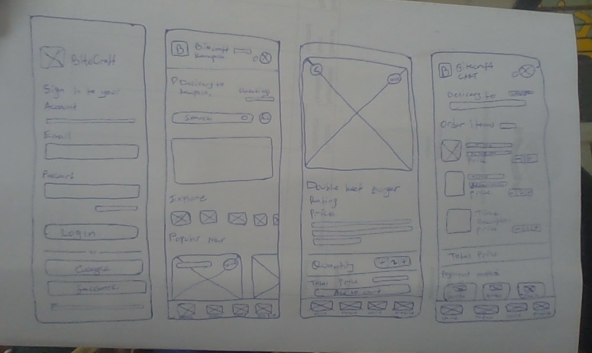

# Design notes

## Design thinking

The design starts with the customer's main task: choose a meal and review the cost before confirming it. The paper sketches organise the screen layout. The Figma designs add colour, typography, photographs and detailed controls. The web interface turns these controls into working navigation and forms.

## Ideas considered

| Idea | Benefit | Decision |
| --- | --- | --- |
| Place all options on the menu card | Fewer screen changes | Cards become crowded |
| Open a separate food details screen | More room for description and choices | Selected for customisation |
| Confirm immediately after adding food | Shorter journey | Little opportunity to review quantities |
| Review the cart before checkout | Makes prices and choices visible together | Selected for order review |

## Paper sketches

The sketches show Login, Home, Food details and Cart. They establish the placement of the search field, food photographs, quantities, totals and bottom navigation.

## High fidelity design

[Open the Figma project](https://www.figma.com/design/uXvZEoR0YnAhbe41bstIhl/food-deliver?node-id=0-1).

The file contains Welcome, Login, Home, Menu, Food details, Cart and Profile screens. [Direct screen links and exported designs](design/README.md) are included with the documentation.

| Element | Choice |
| --- | --- |
| Primary colour | `#B41F04` |
| Heading font | Plus Jakarta Sans |
| Body font | Inter |
| Main food lists | One full-width card per row |
| Category and popular-food rows | Horizontal scrolling |
| Navigation | Home, Menu, Cart and Profile |
| Default profile image | Supplied Sanyu Judith photograph |

Food cards group the photo, name and price, rating, timing and delivery information, followed by an Add to Cart button. The app keeps the mobile layout at a maximum width of 440 pixels on wider screens.

## Feedback and accessibility

Labels identify form fields, error messages explain invalid entries, and messages confirm saved actions. Buttons have focus styles, images have alternative text, and the navigation labels remain visible. The selected size, spice and payment choice have visible states.
