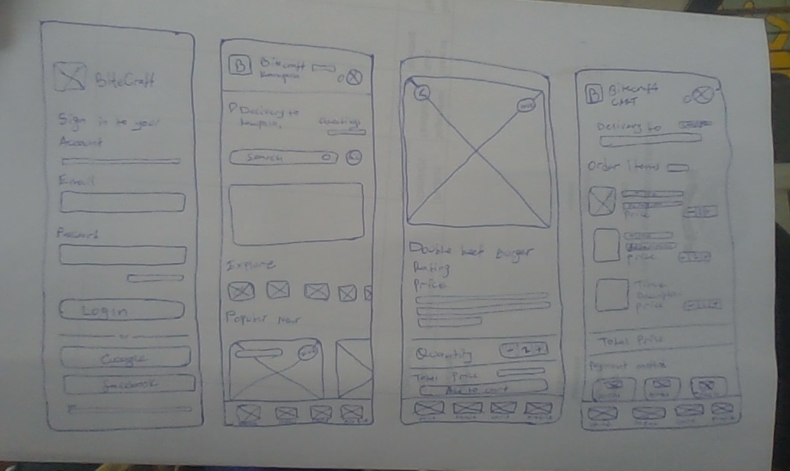
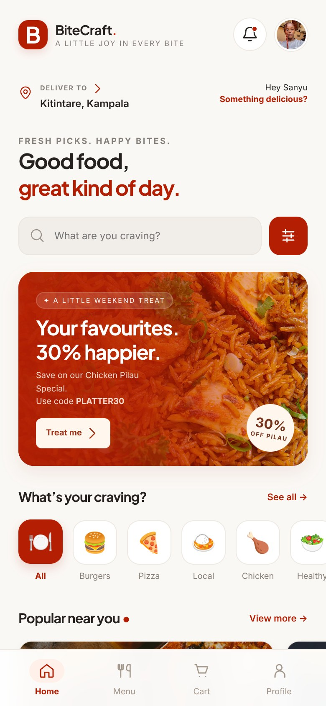
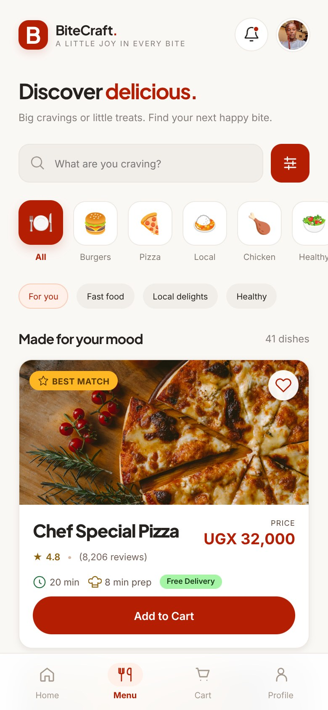
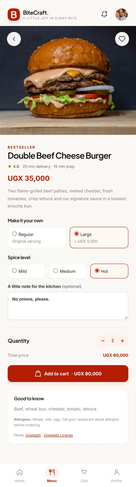
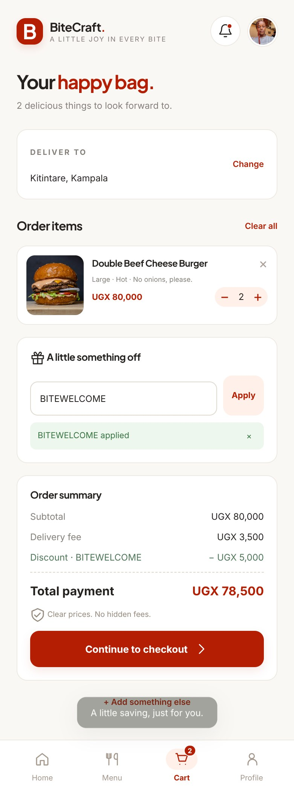

# BiteCraft UI UX Design Report

**Student:** Sanyu Judith  
**Project:** Mobile food ordering interface  
**Date:** 7 November 2026

## Introduction

BiteCraft helps a customer browse food and drinks, customise a meal and review the total before confirming an order. The main journey is Home → Menu → Food details → Cart → Checkout → Confirmation. The interface uses HTML, CSS and JavaScript.

## User research and problem definition

The research focuses on the tasks involved in ordering food on a phone. The paper sketches and Figma screens were reviewed, then the main tasks were followed through the interface. Intended users include students comparing prices, busy workers choosing a meal quickly and returning customers looking for familiar dishes.

The task analysis identified a need for clear prices, quick search, simple customisation and an itemised total. BiteCraft addresses these needs with food cards, search and categories, a separate details page and an editable cart. [User research](RESEARCH.md).

The problem is that an order can be difficult to check when dish options, quantities and delivery costs are spread across different steps. BiteCraft groups the important information and shows the total before confirmation. [Main requirements](REQUIREMENTS.md).

## Ideas and paper sketches

A separate details page gives enough room for size, spice, quantity and kitchen notes. A cart review gives the customer a chance to check those choices and the cost before checkout.

The sketches show Login, Home, Food details and Cart. They establish the position of the main fields, photographs, totals and navigation. [Design notes](DESIGN.md).

## High fidelity design

The [Figma project](https://www.figma.com/design/uXvZEoR0YnAhbe41bstIhl/food-deliver?node-id=0-1) contains seven mobile screens. The [design gallery](design/README.md) includes direct links and exports of Menu, Food details and Cart.

The primary colour is #B41F04. Plus Jakarta Sans is used for headings and Inter for body text. Main food lists use one full-width card per row, while category and popular-food rows scroll horizontally. The default profile photograph is Sanyu Judith's supplied image.

## Web implementation

HTML loads the page, CSS controls the appearance and responsive layout, and JavaScript handles navigation, forms, calculations and saved records. The app includes 41 dishes across 11 categories, search and filters, meal options, favourites, saved addresses, order history and profile settings.

The dish details page records size, spice level, quantity and an optional note. The cart preserves these choices and calculates the subtotal, discount, delivery fee and total.

Checkout validates the required delivery details and records the selected payment preference. Confirmation shows the saved order, receipt and tracking steps. [All implementation screenshots](screenshots/README.md).

## Testing and demonstration

The ten automated tests passed. The browser walkthrough checks menu filtering, card layout, customisation, cart totals, checkout validation, confirmation and saved records. [Full results](TESTING.md).

The example order contains two Large burgers, with Hot spice and a kitchen note. Its subtotal is 80,000 UGX. The welcome code reduces this by 5,000 UGX, and delivery adds 3,500 UGX. The total is 78,500 UGX.

The [presentation guide](PRESENTATION.md) explains how to show the sketches, Figma screens and working ordering journey.

## Conclusion

BiteCraft brings food discovery, meal choices and order review into a clear mobile interface. The paper sketches, Figma designs and working website show the development of the same ordering journey.

## Project links

- [Website](https://bite-craft-lemon.vercel.app/)
- [Repository](https://github.com/abarintuma/bite-craft)
- [Figma project](https://www.figma.com/design/uXvZEoR0YnAhbe41bstIhl/food-deliver?node-id=0-1)
- [PDF report](BiteCraft_Project_Report.pdf)
