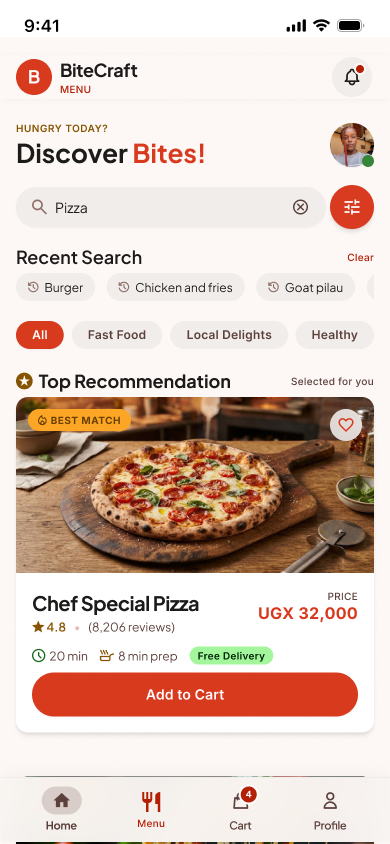
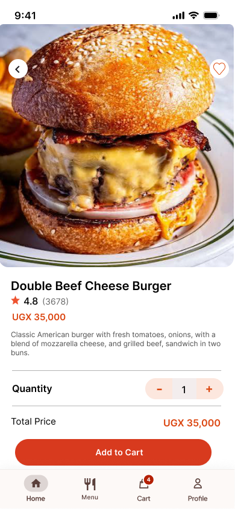
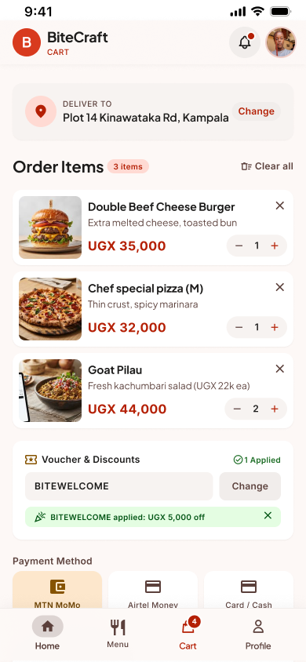

# Design evidence

## Paper sketches

[Open the original hand-drawn sketches](paper-sketches.jpeg).

## Figma project

[Open the editable Figma file](https://www.figma.com/design/uXvZEoR0YnAhbe41bstIhl/food-deliver?node-id=0-1).

| Screen | Direct Figma link |
| --- | --- |
| Welcome | [Open](https://www.figma.com/design/uXvZEoR0YnAhbe41bstIhl/food-deliver?node-id=48-117) |
| Login | [Open](https://www.figma.com/design/uXvZEoR0YnAhbe41bstIhl/food-deliver?node-id=47-55) |
| Home | [Open](https://www.figma.com/design/uXvZEoR0YnAhbe41bstIhl/food-deliver?node-id=53-262) |
| Menu | [Open](https://www.figma.com/design/uXvZEoR0YnAhbe41bstIhl/food-deliver?node-id=138-361) |
| Food details | [Open](https://www.figma.com/design/uXvZEoR0YnAhbe41bstIhl/food-deliver?node-id=187-1838) |
| Cart | [Open](https://www.figma.com/design/uXvZEoR0YnAhbe41bstIhl/food-deliver?node-id=149-106) |
| Profile | [Open](https://www.figma.com/design/uXvZEoR0YnAhbe41bstIhl/food-deliver?node-id=187-1474) |

All seven phone frames are 390 × 844 pixels. The file structure was inspected and the following three screens were exported directly from Figma on 7 November 2026.

### Menu

### Food details

### Cart

The [supplied overview](figma-overview.jpg) and [additional screen reference](figma-details.jpg) show the wider set of designs. Working website screenshots are in the [implementation gallery](../screenshots/README.md).
