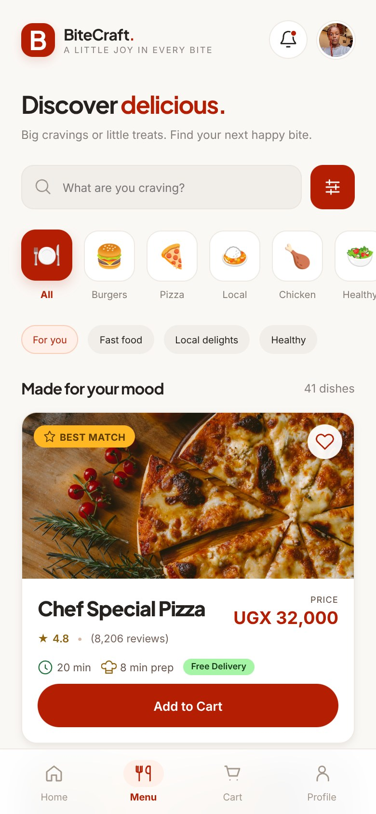

# Mobile implementation screenshots

These screenshots show the working website at a phone width of 390 pixels. Long screens include the full page so that their controls and totals can be read.

| Screen | Image | What it shows |
| --- | --- | --- |
| Login | [Open](login.jpg) | Sign-in and account creation options |
| Home | [Open](home.jpg) | Search, offer and categories |
| Menu | [Open](menu.jpg) | Full-width food cards and prices |
| Food details | [Open](item.jpg) | Large Hot burger, quantity two and kitchen note |
| Cart | [Open](cart.jpg) | Saved choices, welcome code and total |
| Checkout | [Open](checkout.jpg) | Delivery details and payment preference |
| Confirmation | [Open](tracking.jpg) | Recorded order and tracking steps |
| Profile | [Open](profile.jpg) | Sanyu Judith's photograph and account options |

The cart example has two Large burgers at 40,000 UGX each. After the 5,000 UGX welcome discount and 3,500 UGX delivery fee, the total is 78,500 UGX.
